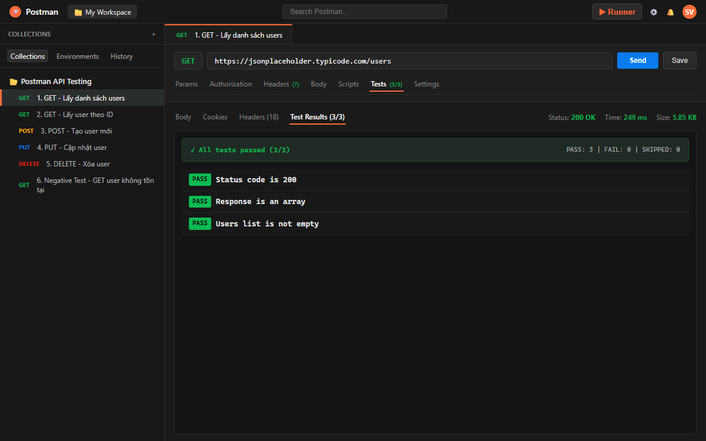
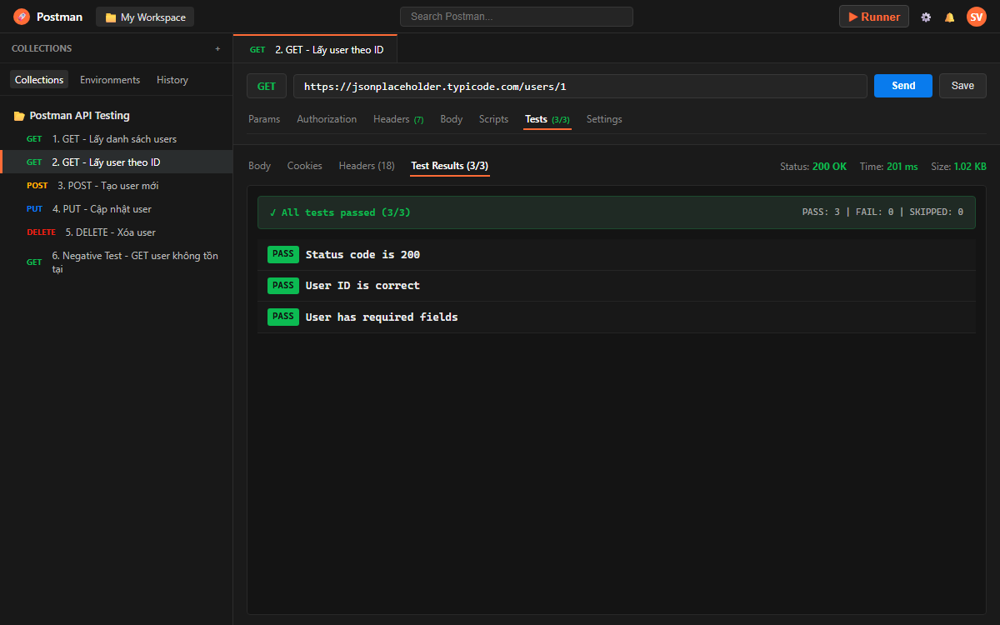
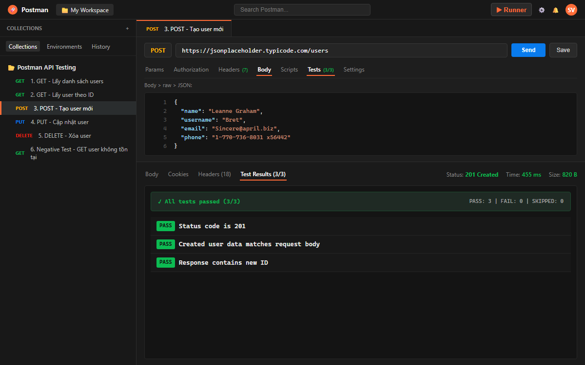
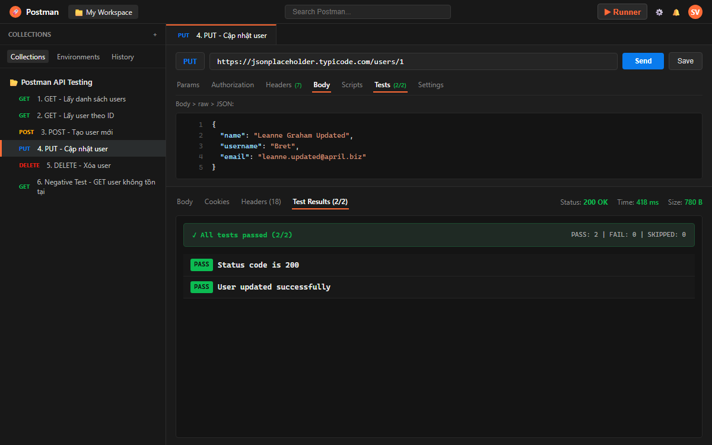
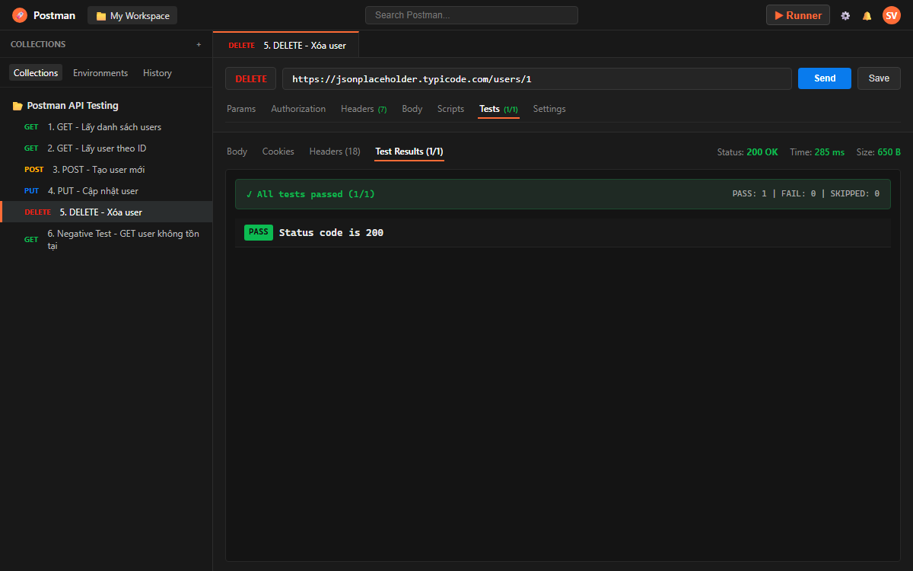
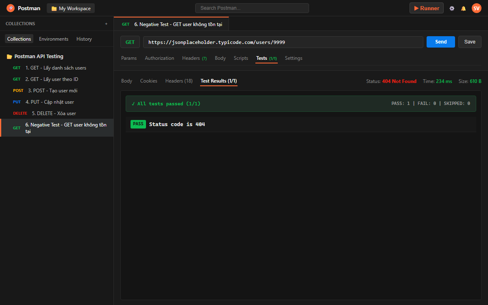
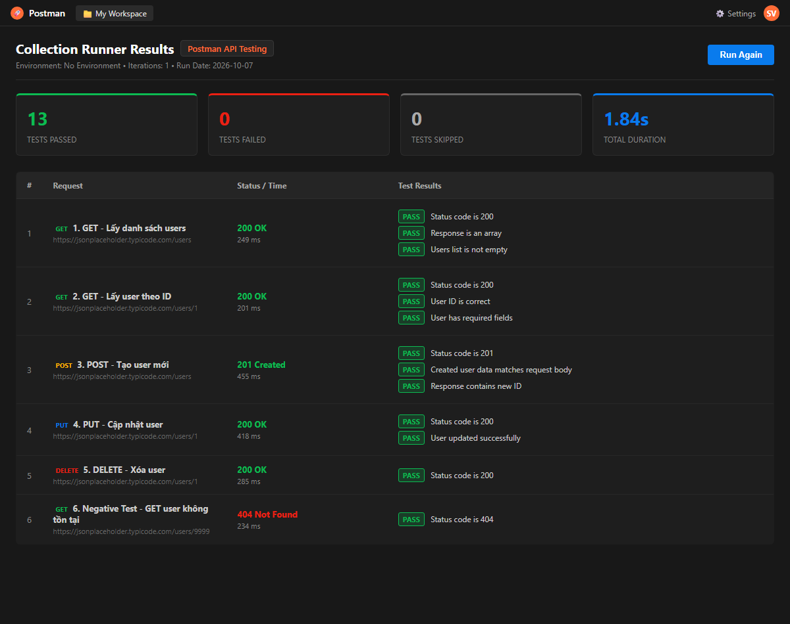

# Báo Cáo Thực Hành: Kiểm Thử REST API Bằng Postman

Bài thực hành môn **Kiểm thử phần mềm** — Làm quen với công cụ Postman và kiểm thử các phương thức REST API cơ bản.

---

## 1. Giới thiệu

- **Mục đích bài thực hành:** Làm quen với công cụ Postman, hiểu cách gửi các HTTP request (GET, POST, PUT, DELETE), viết kịch bản kiểm thử tự động (Test Script) và chạy kiểm thử hàng loạt với Collection Runner.
- **Công cụ sử dụng:** Postman Desktop App, Git & GitHub.
- **API sử dụng:** JSONPlaceholder REST API (`https://jsonplaceholder.typicode.com`) — REST API công khai phục vụ kiểm thử và mô phỏng dữ liệu.

---

## 2. Môi trường thực hiện

- **Hệ điều hành:** Windows
- **Công cụ kiểm thử:** Postman Desktop App (Version 11.x)
- **REST API:** JSONPlaceholder (`https://jsonplaceholder.typicode.com`)
- **Quản lý mã nguồn:** GitHub Repository

---

## 3. Các API đã kiểm thử

Dưới đây là danh sách các API endpoints và phương thức HTTP được thực hiện kiểm thử trong bài thực hành:

| STT | Method | Endpoint | Mục đích kiểm thử |
|---|---|---|---|
| 1 | `GET` | `/users` | Lấy toàn bộ danh sách users |
| 2 | `GET` | `/users/1` | Lấy thông tin chi tiết user theo ID (ID = 1) |
| 3 | `POST` | `/users` | Tạo mới một user vào hệ thống |
| 4 | `PUT` | `/users/1` | Cập nhật thông tin user theo ID (ID = 1) |
| 5 | `DELETE` | `/users/1` | Xóa user khỏi hệ thống theo ID (ID = 1) |
| 6 | `GET` | `/users/9999` | **Negative Test**: Kiểm tra lỗi khi user không tồn tại |

---

## 4. Kết quả thực hiện chi tiết

### 4.1. GET — Lấy danh sách users (`/users`)

- **Mô tả:** Gửi yêu cầu lấy danh sách toàn bộ người dùng từ server.
- **Test Scripts:**
  ```javascript
  pm.test("Status code is 200", function () {
      pm.response.to.have.status(200);
  });

  pm.test("Response is an array", function () {
      var jsonData = pm.response.json();
      pm.expect(jsonData).to.be.an("array");
  });

  pm.test("Users list is not empty", function () {
      var jsonData = pm.response.json();
      pm.expect(jsonData.length).to.be.above(0);
  });
  ```
- **Kết quả:** Status Code `200 OK`, trả về danh sách 10 users ở định dạng JSON mảng. Cả 3/3 test case đều **PASS**.



---

### 4.2. GET — Lấy thông tin user theo ID (`/users/1`)

- **Mô tả:** Lấy thông tin chi tiết của người dùng có `id = 1`.
- **Test Scripts:**
  ```javascript
  pm.test("Status code is 200", function () {
      pm.response.to.have.status(200);
  });

  pm.test("User ID is correct", function () {
      var jsonData = pm.response.json();
      pm.expect(jsonData.id).to.eql(1);
  });

  pm.test("User has required fields", function () {
      var jsonData = pm.response.json();
      pm.expect(jsonData).to.have.property("name");
      pm.expect(jsonData).to.have.property("username");
      pm.expect(jsonData).to.have.property("email");
  });
  ```
- **Kết quả:** Status Code `200 OK`, ID trả về chính xác là `1` và có đầy đủ các trường `name`, `username`, `email`. Cả 3/3 test case đều **PASS**.



---

### 4.3. POST — Tạo user mới (`/users`)

- **Mô tả:** Gửi dữ liệu JSON lên server để thêm người dùng mới.
- **Request Body (raw JSON):**
  ```json
  {
    "name": "Leanne Graham",
    "username": "Bret",
    "email": "Sincere@april.biz",
    "phone": "1-770-736-8031 x56442"
  }
  ```
- **Test Scripts:**
  ```javascript
  pm.test("Status code is 201", function () {
      pm.response.to.have.status(201);
  });

  pm.test("Created user data matches request body", function () {
      var jsonData = pm.response.json();
      pm.expect(jsonData.name).to.eql("Leanne Graham");
      pm.expect(jsonData.username).to.eql("Bret");
      pm.expect(jsonData.email).to.eql("Sincere@april.biz");
  });

  pm.test("Response contains new ID", function () {
      var jsonData = pm.response.json();
      pm.expect(jsonData).to.have.property("id");
  });
  ```
- **Kết quả:** Status Code `201 Created`, response chứa đúng thông tin người dùng gửi lên và được gán `id = 11`. Cả 3/3 test case đều **PASS**.



---

### 4.4. PUT — Cập nhật thông tin user (`/users/1`)

- **Mô tả:** Cập nhật thông tin người dùng có `id = 1`.
- **Request Body (raw JSON):**
  ```json
  {
    "name": "Leanne Graham Updated",
    "username": "Bret",
    "email": "leanne.updated@april.biz"
  }
  ```
- **Test Scripts:**
  ```javascript
  pm.test("Status code is 200", function () {
      pm.response.to.have.status(200);
  });

  pm.test("User updated successfully", function () {
      var jsonData = pm.response.json();
      pm.expect(jsonData.name).to.eql("Leanne Graham Updated");
      pm.expect(jsonData.email).to.eql("leanne.updated@april.biz");
  });
  ```
- **Kết quả:** Status Code `200 OK`, dữ liệu sau cập nhật hiển thị chính xác theo nội dung đã gửi. Cả 2/2 test case đều **PASS**.



---

### 4.5. DELETE — Xóa user (`/users/1`)

- **Mô tả:** Gửi yêu cầu xóa người dùng có `id = 1`.
- **Test Scripts:**
  ```javascript
  pm.test("Status code is 200", function () {
      pm.response.to.have.status(200);
  });
  ```
- **Kết quả:** Status Code `200 OK`, response trả về đối tượng rỗng `{}` biểu thị việc xóa thành công. Test case **PASS**.



---

### 4.6. Negative Test — Lấy user không tồn tại (`/users/9999`)

- **Mô tả:** Gửi yêu cầu truy vấn thông tin người dùng với ID không tồn tại (`9999`) để kiểm tra phản hồi lỗi của hệ thống.
- **Test Scripts:**
  ```javascript
  pm.test("Status code is 404", function () {
      pm.response.to.have.status(404);
  });
  ```
- **Kết quả:** Status Code `404 Not Found`, hệ thống xử lý đúng trường hợp dữ liệu không tồn tại. Test case **PASS**.



---

## 5. Kết quả chạy Collection Runner

Toàn bộ các request trong Collection **Postman API Testing** đã được thực thi tự động thông qua tính năng **Collection Runner** của Postman:



- **Tổng số request đã chạy:** 6 requests
- **Tổng số test assertions:** 13 tests
- **Số test Passed:** 13 / 13 (100%)
- **Số test Failed:** 0
- **Số test Skipped:** 0
- **Tổng thời gian thực thi:** 1.84s
- **Đánh giá:** Tất cả các test case đều thực hiện thành công.

---

## 6. Kết luận

Qua bài thực hành kiểm thử phần mềm này, em đã làm quen và nắm vững các kỹ năng cơ bản về kiểm thử REST API bằng Postman:
- Cách thiết lập và gửi các loại HTTP request phổ biến (`GET`, `POST`, `PUT`, `DELETE`).
- Cách truyền dữ liệu qua URL, Headers và Request Body (JSON).
- Cách phân tích và kiểm tra Response (HTTP Status Code, Response Body, Response Time).
- Cách viết các Test Script đơn giản bằng cú pháp `pm.test` và `pm.expect` để tự động hóa kiểm tra kết quả.
- Cách sử dụng **Collection Runner** để kiểm thử tự động toàn bộ API Collection và xuất kết quả trực quan.
- Cách export Collection thành file JSON và quản lý mã nguồn bài nộp trên **GitHub**.

---

## 7. Cấu trúc thư mục Repository

```text
Postman_API/
├── README.md                          # Báo cáo thực hành
├── postman/
│   └── API-Testing-Collection.json    # File Postman Collection đã export
└── screenshots/                       # Thư mục ảnh chụp kết quả thực tế
    ├── get-users.png
    ├── get-user.png
    ├── post-user.png
    ├── put-user.png
    ├── delete-user.png
    ├── negative-test.png
    └── collection-runner.png
```
